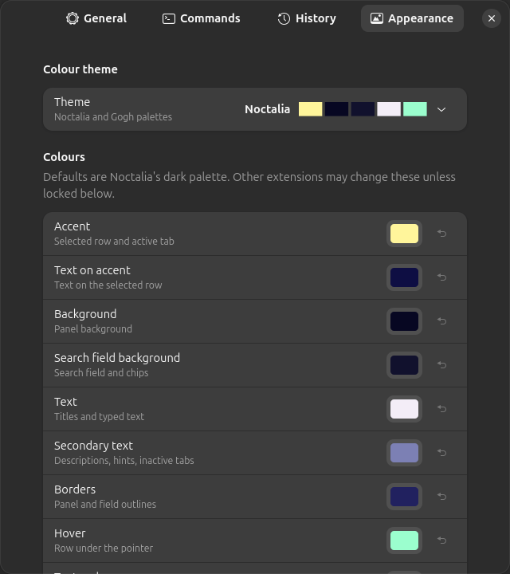
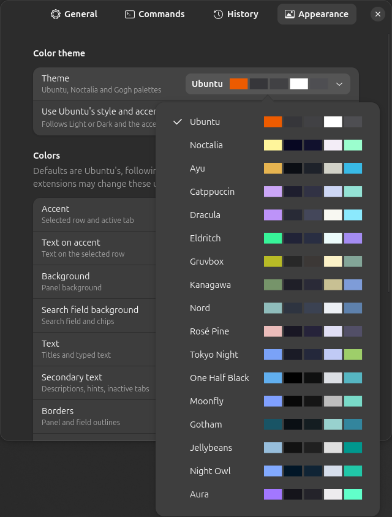

# Conjure Launcher

A keyboard-first application launcher for GNOME Shell 50+, modelled on the launcher in
[Noctalia](https://github.com/noctalia-dev/noctalia) (MIT). It is built as a GNOME Shell extension
because Mutter does not implement `wlr-layer-shell`, so a standalone Wayland launcher cannot draw
over the desktop. It opens on Super+Space, in place of GNOME's "Show Apps" grid.

Version 0.7.0. How it works is described in `docs/architecture.md`; the theming interface for
other programs is in `docs/theming.md`.

## Screenshots

| | |
|---|---|
|  |  |
| Recent (the opening view) | Fuzzy search |
|  |  |
| All apps as a grid (Ctrl+G) | Categories |
|  |  |
| Actions (Shift+Enter) | Calculator |
|  |  |
| `/emo` | `/` lists the providers |

### Themes

The shots above use the default, Ubuntu following the system (here dark, with Ubuntu's orange).

| | | |
|---|---|---|
|  |  |  |
| Ubuntu Light | Noctalia | Catppuccin |
|  |  |  |
| Dracula | Gruvbox | Kanagawa |
|  |  |  |
| Nord | Rosé Pine | Tokyo Night |
|  |  | |
| Moonfly | Oxocarbon | |

### Settings

| | |
|---|---|
|  |  |
| Settings → Appearance | The theme list, with each theme's colours |

The screenshots are generated by `tools/screenshots.sh` in a headless shell.

## Installing

From a checkout:

```sh
tools/install.sh                                  # links the checkout into ~/.local/share/gnome-shell/extensions
gnome-extensions enable conjure-launcher@excelsies
```

On Wayland, GNOME Shell loads a newly installed extension only at its next start, so log out
and back in. Logging out closes every open app, terminals included. If `gnome-extensions enable`
says the extension does not exist (the running shell has not seen it yet), enable it after
logging in, or with Extension Manager. `tools/pack.sh` builds a zip for
`gnome-extensions install` instead.

On stock GNOME, Super+Space also switches input sources. The launcher never changes that
binding: it logs the clash, and Super+Space does not reach the launcher while the other binding
holds it. Clear it (GNOME Settings → Keyboard → View and Customize Shortcuts → Typing → Switch to
next input source), or give the launcher another shortcut in its Settings → General. The launcher
takes the Show Apps shortcut (`toggle-application-view`) only if it is the same as its own, and
gives it back when disabled.

## Using it

| Key | Action |
|---|---|
| Super+Space | Open or close the launcher |
| Type | Search all apps (fuzzy) |
| Up / Down, Tab / Shift+Tab, Ctrl+N / Ctrl+P | Move the selection (Left / Right too in the grid) |
| Page Up / Page Down | Move by a page |
| Enter | Open (or switch to) the app; Ctrl+Enter or middle-click opens a new window |
| Shift+Enter, right-click | Actions: open, new window, the app's own actions, pin / unpin |
| Ctrl+Tab / Ctrl+Shift+Tab, Ctrl+1..4 | Switch view: Recent, Pinned, All, Categories |
| Ctrl+Left / Ctrl+Right | Previous / next category (Categories view) |
| Ctrl+G | Toggle list / grid |
| Ctrl+, or the gear in the search field | Open Settings |
| Esc | Leave the actions menu, or close |

| Type | To get |
|---|---|
| `12*3`, `sqrt(2)*10` | The calculator result first (Enter copies it). `/calc …` for anything else |
| `/emo heart` | Emoji (Enter copies) |
| `/win term` | Open windows, most recent first (Enter switches) |
| `/session sleep` | Lock, log out, suspend, switch user, restart, power off |
| `/` | The list of providers; Enter fills in the prefix |
| `/wall sunset` | Images in `~/Pictures/Wallpapers` (setting `wallpaper-dir`); Enter sets the background |
| `/<your prefix>` | Your own command entries (below) |
| anything else | Apps, plus results from GNOME's search providers (files, Settings, ...) as enabled in GNOME Settings > Search. GNOME Calculator's provider is left out (the launcher has its own) |

### Command entries

Define your own providers in **Settings → Commands** (add, edit, delete), or edit
`~/.config/conjure-launcher/commands.json` directly; both use the same file. It is reloaded
whenever it is saved; invalid entries are skipped and named in the log and in Settings. Settings
never overwrites a file that does not parse or that changed on disk while it was open, and it
keeps fields it does not know about.

```json
{
  "version": 1,
  "entries": [
    {
      "id": "ssh", "prefix": "ssh", "label": "SSH hosts", "icon": "network-server-symbolic",
      "command": "grep -oP '^Host \\K[^*\\s]+' ~/.ssh/config",
      "exec": "ptyxis -- ssh {selection}",
      "freeform": true
    },
    { "id": "web", "prefix": "g", "label": "Web search", "exec": "xdg-open https://duckduckgo.com/?q={query}" }
  ]
}
```

| Field | Meaning |
|---|---|
| `id`, `prefix` | a-z, 0-9 and `-`. `prefix` is the trigger word (`/ssh`); built-in ones cannot be reused |
| `command` | Prints one candidate per line (`title<TAB>subtitle` is allowed). Runs once per open; 2 s limit |
| `exec` | Runs on Enter. `{selection}` is the chosen line, `{query}` the typed text. **Do not put quotes around them**: they are passed safely as separate arguments, never pasted into the command |
| no `exec` | Enter copies the selection |
| `freeform` | Also offer the typed text itself (listed after real matches) |
| `global` | Also show this entry's candidates in normal search |
| `label`, `icon` | Display name and a symbolic icon name |

### dmenu mode

`tools/install.sh` puts `conjure-dmenu` in `~/.local/bin`. Scripts pipe choices in and read the
pick back, like `rofi -dmenu`:

```sh
choice=$(printf 'red\ngreen\nblue\n' | conjure-dmenu -p 'Pick a colour') && echo "$choice"
```

Exit status: 0 picked (the whole line is printed), 1 cancelled, 2 Conjure Launcher not running.
With no match, Enter returns what you typed.

Calculator: `+ - * / % ^ !`, parentheses, `sqrt cbrt abs round floor ceil sin cos tan asin acos
atan ln log log2 exp pow min max`, `pi tau e`. Trigonometry is in radians.

Settings: `gnome-extensions prefs conjure-launcher@excelsies`. They cover placement, the monitor
(focused window, pointer or primary), search field position, width, opening view, grid,
auto-paste, the wallpaper folder, the shortcut, history and colours.

Colour themes (Settings → Appearance), each shown with its swatches in the list:
- **Ubuntu** (the default), from Ubuntu's Yaru theme. With "Use Ubuntu's style and accent colour" on,
  it follows GNOME Settings → Appearance live: Light or Dark, and the accent colour you picked there.
  Turn it off to choose Ubuntu Light or Ubuntu Dark yourself, with Ubuntu orange. Choosing any other
  theme also stops following.
- Noctalia's palettes: Noctalia, Ayu, Catppuccin, Dracula, Eldritch, Gruvbox, Kanagawa,
  Nord, Rosé Pine and Tokyo Night.
- Ten darker ones from the Gogh collection: One Half Black, Moonfly, Gotham, Jellybeans, Night Owl,
  Aura, Oxocarbon, Oceanic Next, Molokai and Tomorrow Night.

Each theme is checked for readable contrast as the launcher draws it, Ubuntu with each of Ubuntu's ten
accent colours in both styles. Adjusting any single colour
after picking a theme shows "Custom". A theme writes the same `theme-*` keys that other programs
can set (`docs/theming.md`).

Auto-paste (off by default) pastes copied calculator results and emoji into the window you were
in, and never into any other window.

## Development

| Command | What it does |
|---|---|
| `pnpm install` | Install the lint and test tools (dev only; nothing ships to the shell). pnpm is pinned in `package.json`; `corepack enable` provides it |
| `pnpm run check` | ESLint, unit tests (`tests/**/*.test.js`), GJS tests (`tests/gjs`) and schema validation; CI runs the same |
| `pnpm test:shell` | Headless GNOME Shell integration tests (`tests/shell`): no window, its own D-Bus session and temporary XDG dirs, and session actions stubbed. Runs under your uid, so it shares your per-user kernel limits (inotify) while it runs. Not run by CI (`docs/architecture.md`, Known limitations) |
| `pnpm test:shell:container` | The same tests in a GNOME Shell 50 container under a separate uid. **Experimental:** about half of container starts stall before `startup-complete` (see `docs/architecture.md`, Known limitations) |
| `tools/preview.sh` | Opens the launcher in a nested GNOME Shell window to look at and try, without installing or logging out. It uses temporary settings, your apps read-only, and nothing launches (actions show a notice). Close the window to stop |
| `tools/install.sh` | Symlink this checkout into `~/.local/share/gnome-shell/extensions/` |
| `tools/devkit.sh` | Run a nested GNOME Shell with only this extension enabled, using a temporary settings database. Needs `sudo apt install mutter-dev-bin` |
| `tools/pack.sh` | Build the installable zip into `dist/` |
| `tools/ego-check.sh` | Build the zip, check it against the extensions.gnome.org review rules, and smoke-test the zip headless |
| `tools/screenshots.sh` | Regenerate `docs/screenshots/` headless, with a fixed set of standard GNOME apps and nothing launched |

Code under `lib/` must not import `gi://` or Shell modules (ESLint enforces this), so it can be
unit-tested under Node.

Logs: `journalctl --user -f -o cat /usr/bin/gnome-shell | grep conjure-launcher`

Theming for integrations: see `docs/theming.md`. Publishing to extensions.gnome.org:
`tools/ego-check.sh`, then `docs/publishing.md`.
